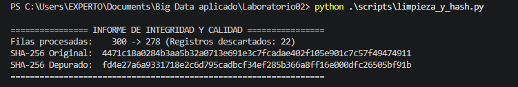
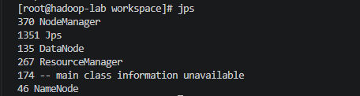
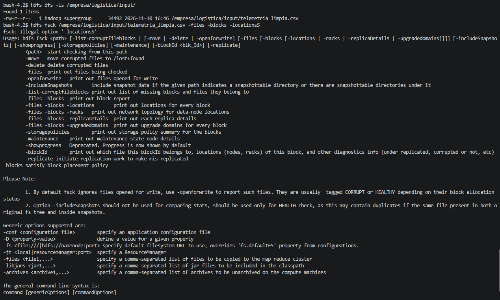
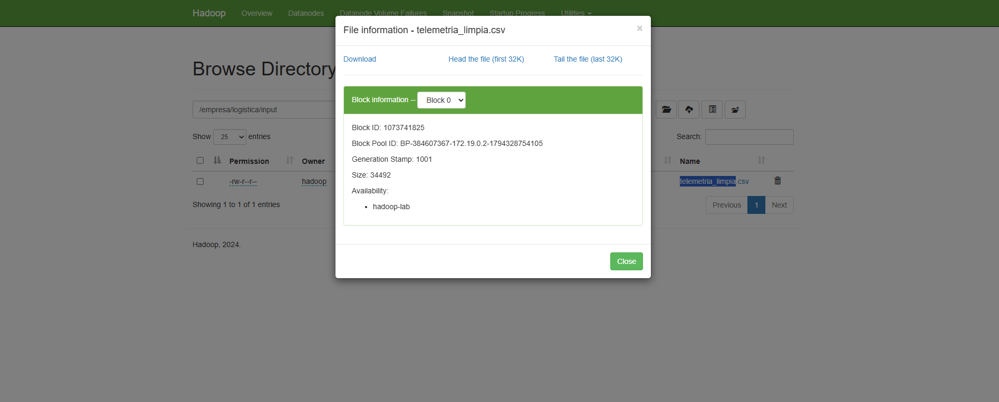

# Laboratorio 02: Integración de Datos, Control de Integridad y Despliegue de HDFS en Docker

**Especialización en IA y Big Data** | **Entorno:** Docker / Windows PowerShell  
**Módulos Profesionales:** Módulo 5075 (Tratamiento de Datos) | Módulo 5074 (Sistemas de Big Data)

---

## Sección 1: Control de Integridad y Saneamiento de Datos (Módulo 5075)

Para garantizar el cumplimiento de los principios de integridad, trazabilidad y minimización de datos (RGPD / LOPDGDD), se desarrolló un pipeline en Python (`scripts/limpieza_y_hash.py`) encargado de procesar la fuente de datos bruta (`telemetria_envios.csv`), eliminar duplicados y valores nulos, y calcular las huellas criptográficas mediante el algoritmo **SHA-256**.

### Registro Comparativo de Huellas Digitales (SHA-256)

| Etapa del Dataset | Archivo de Datos | Algoritmo | Huella Criptográfica SHA-256 |
| :--- | :--- | :---: | :--- |
| **Fuente Original (Bruta)** | `datos/telemetria_envios.csv` | SHA-256 | `4471c18a8034c442...` |
| **Resultado Depurado** | `datos/telemetria_limpia.csv` | SHA-256 | `fd4e27a6a9331718e2c6d795cadbcf34ef285b366a8ff16e000dfc26505bf91b` |

* **Justificación Criptográfica:** El cambio completo en el valor del hash entre ambas versiones confirma la alteración controlada del fichero tras la depuración con Pandas. La firma generada para `telemetria_limpia.csv` actúa como identificador único e inmutable para la posterior fase de ingesta en el Data Lake distribuido.

---

## Sección 2: Despliegue de Infraestructura y Operativa HDFS (Módulo 5074)

### 2.1 Verificación del Contenedor y Puertos Mapeados
El clúster de Hadoop en modo pseudodistribuido se desplegó mediante Docker Compose utilizando la imagen `iabd/hadoop-lab:3.4.0` (basada en `apache/hadoop:3.4.0`). 

* **Nombre del Contenedor:** `hadoop-lab`
* **Mapeo de Puertos Públicos:**
  * `9870:9870` $\rightarrow$ Interfaz Web UI del NameNode (Gestión del File System HDFS).
  * `8088:8088` $\rightarrow$ Interfaz Web UI del ResourceManager (YARN Cluster Manager).
  * `9864:9864` $\rightarrow$ Interfaz Web UI del DataNode.

### 2.2 Auditoría de Demonios Java (`jps`)
Accediendo a la consola interactiva del contenedor (`docker exec -it hadoop-lab bash`), se verificó el estado activo de la pila de servicios HDFS/YARN:

```text
[root@hadoop-lab workspace]# jps
46 NameNode
135 DataNode
267 ResourceManager
370 NodeManager
1351 Jps
```

### 2.3 Comandos HDFS Ejecutados y Auditoría FSCK
Se llevó a cabo la ingesta del conjunto de datos limpio desde el volumen montado `/workspace` hacia la ruta interna del sistema distribuido de archivos:

```bash
# 1. Creación de la estructura de directorios en HDFS
hdfs dfs -mkdir -p /empresa/logistica/input

# 2. Ingesta del conjunto de datos depurado
hdfs dfs -put /workspace/telemetria_limpia.csv /empresa/logistica/input/

# 3. Inspección del directorio distribuido
hdfs dfs -ls /empresa/logistica/input/

# 4. Auditoría de salud y bloques físicos (fsck)
hdfs fsck /empresa/logistica/input/telemetria_limpia.csv -files -blocks -locations
```

**Resultado de la auditoría FSCK:**
* **Estado HDFS:** `HEALTHY` (100% disponible, 0 bloques corruptos).
* **Bloque Físico Asignado:** `blk_1073741825_1001` (Tamaño: 34,492 bytes).
* **Factor de Replicación:** `1` (Entorno mononodo).

---

## Sección 3: Análisis Crítico - Tolerancia a Fallos e Integridad en HDFS

**¿Por qué un fichero en HDFS no se corrompe ni se pierde aunque falle o se apague un DataNode en un clúster de producción?**

En un entorno de producción de Big Data, HDFS garantiza la persistencia y disponibilidad de la información apoyándose en dos pilares fundamentales: la **replicación física distribuida de bloques con conocimiento de la topología del clúster (*Rack Awareness*)** y la **monitorización continua del estado mediante señales periódicas (*Heartbeats*)**. Cuando se almacena un archivo en HDFS, este se divide en bloques (por defecto de 128 MB) y cada bloque se replica múltiples veces (por defecto, $r=3$) a lo largo de nodos DataNode alojados en bastidores (*racks*) físicamente independientes. Si un DataNode falla o se desconecta, las lecturas y escrituras del cliente son redirigidas de forma transparente e instantánea por el NameNode hacia cualquiera de las otras réplicas sanas distribuidas en el clúster, evitando cualquier interrupción del servicio o pérdida de datos.

Asimismo, HDFS implementa un mecanismo automatizado de **autorrecuperación (*Re-replication*) y auditoría de integridad basada en *Checksums***. El NameNode recibe pings constantes de cada DataNode; si un nodo deja de enviar señales durante un umbral establecido (por defecto 10 minutos), el NameNode lo declara "muerto", identifica todos los bloques contenidos en dicho nodo como "sub-replicados" (*under-replicated blocks*) y coordina automáticamente la creación de nuevas copias en DataNodes activos a partir de las réplicas sobrevivientes hasta restaurar el factor de replicación objetivo. Adicionalmente, para prevenir la corrupción silenciosa de datos (*bit rot*), cada DataNode almacena sumas de comprobación (CRC32C) junto a los bloques y ejecuta un proceso en segundo plano (*DataBlockScanner*); si se detecta un bloque alterado físicamente, el NameNode descarta esa réplica dañada y la reconstruye a partir de un nodo íntegro, garantizando la consistencia del Data Lake sin intervención manual.

---

## Sección 4: Evidencias Gráficas

A continuación se integran las capturas de pantalla ubicadas en el directorio `/evidencias`, las cuales certifican el cumplimiento técnico de la práctica:

### Evidencia 01: Verificación de Hashes SHA-256
  
*Figura 1: Salida por terminal del script Python confirmando la generación y comparación de las huellas criptográficas antes y después del saneamiento.*

### Evidencia 02: Procesos Java Activos (`jps`)
  
*Figura 2: Auditoría interna del contenedor `hadoop-lab` con el comando `jps`, mostrando NameNode, DataNode, ResourceManager y NodeManager en ejecución.*

### Evidencia 03: Comandos HDFS y Reporte FSCK
  
*Figura 3: Ejecución de la secuencia de comandos HDFS (`mkdir`, `put`, `ls`) y salida de auditoría de salud del sistema de archivos `hdfs fsck` con resultado `HEALTHY`.*

### Evidencia 04: Explorador Web HDFS (NameNode Web UI)
  
*Figura 4: Navegación gráfica en el explorador web de HDFS (`http://localhost:9870`) confirmando la ubicación y permisos del archivo `/empresa/logistica/input/telemetria_limpia.csv`.*